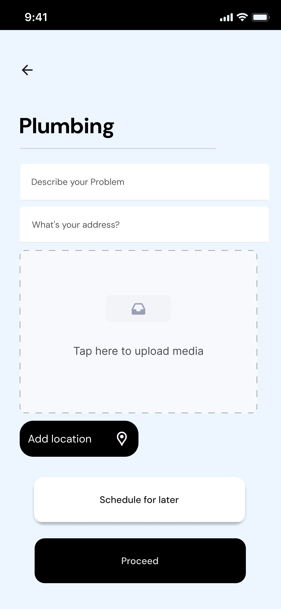
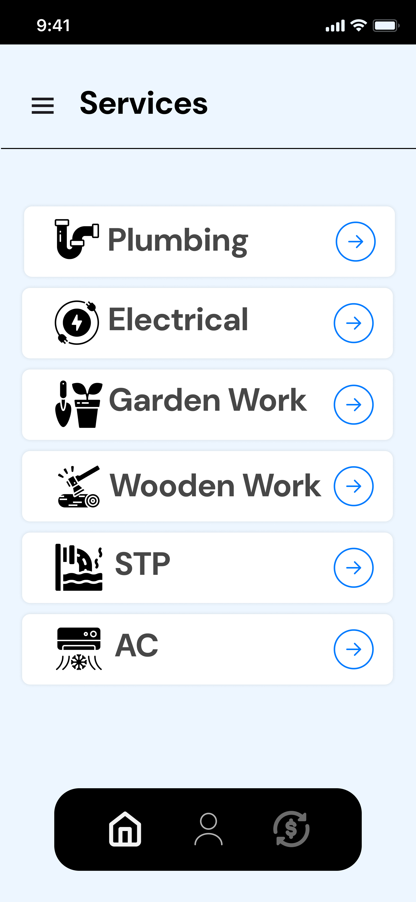
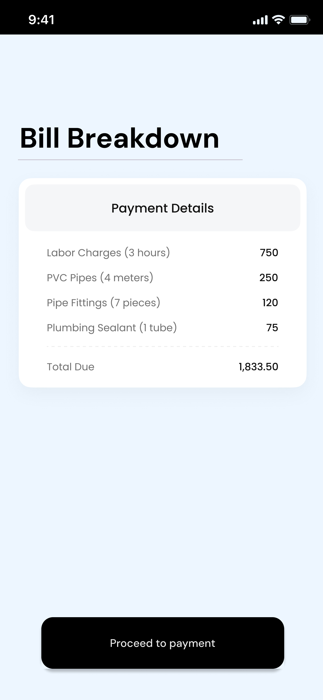

🛠️ Erguo

A Flutter mobile app for booking home services in Kerala. Pick your city, choose a service, describe the problem, and pay from a clear itemized bill.

Show Image Show Image Show Image Show Image Show Image

📱 Screenshots
Select Location	Services	Book a Service	Bill Breakdown
			
✨ Features
📍 Choose your location: Thrissur, Ernakulam, Alappuzha and Palakkad.
🧰 Wide range of services: Plumbing, Electrical, Garden Work, Wooden Work, STP and AC.
📝 Simple service request: describe the problem, enter your address and add your location.
📷 Upload media: attach photos or videos of the issue.
🗓️ Flexible booking: proceed now or schedule for later.
🧾 Transparent billing: itemized bill with labor and material charges before you pay.
💳 Payment: proceed to payment from the bill screen.
🛠️ Tech Stack
Technology	Purpose
Flutter (Dart)	Cross-platform mobile UI
Supabase	Backend
Firebase	Platform services

Confirm what Supabase and Firebase are used for in this project (for example auth, database, storage or notifications) and edit this table to match.

🚀 Getting Started
Prerequisites
Flutter SDK
Android Studio or VS Code with the Flutter extension
A Supabase project and a Firebase project
An emulator or a physical device
Run locally
bash
# Clone the repository
git clone https://github.com/sherledge/erguo.git
cd erguo

# Install dependencies
flutter pub get

# Run the app
flutter run
Configuration

Add your own keys before running. Never commit real keys to the repo.

Supabase: add your project URL and anon key where the app initializes Supabase.
Firebase: run flutterfire configure to generate your Firebase options for the project.
Build an APK
bash
flutter build apk --release
📂 Project Structure
lib/        # App source code
assets/     # Images, icons and other static assets
supabase/   # Supabase configuration and backend files
android/    # Android platform code
ios/        # iOS platform code
test/       # Tests
🗺️ Roadmap
 Service provider app or dashboard
 Live job tracking
 Ratings and reviews
 More cities and services
👤 Author

Shabeer
